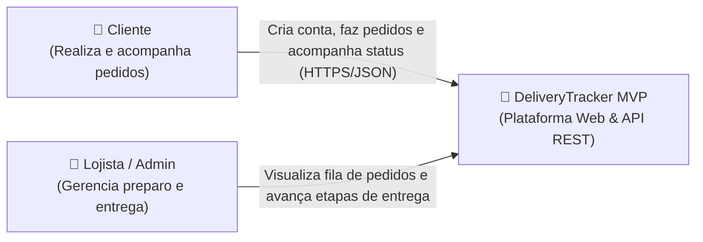
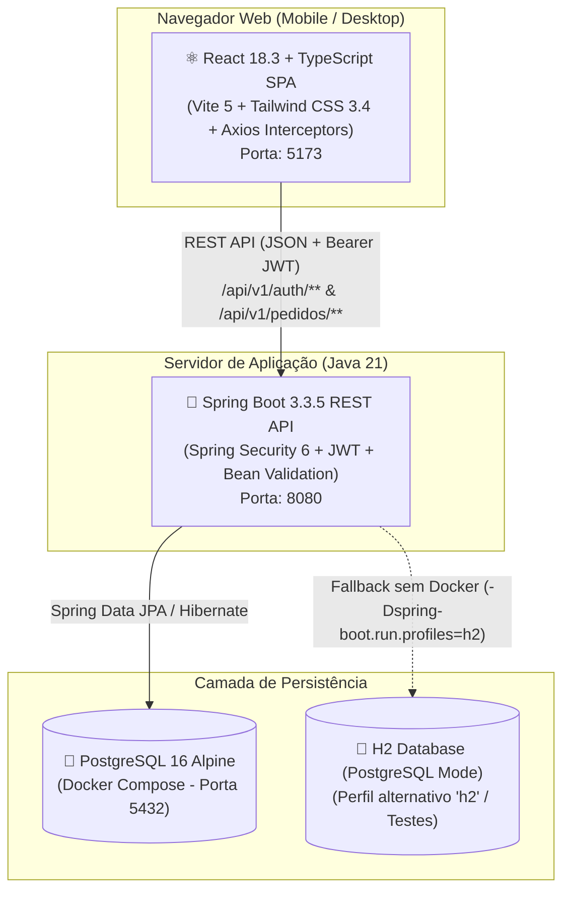
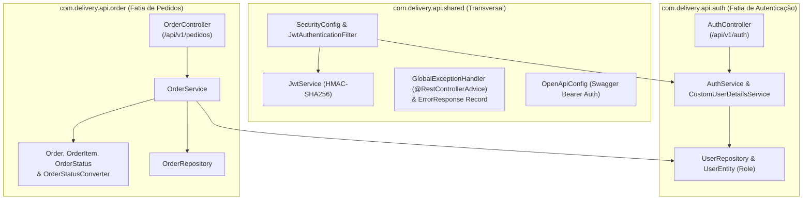
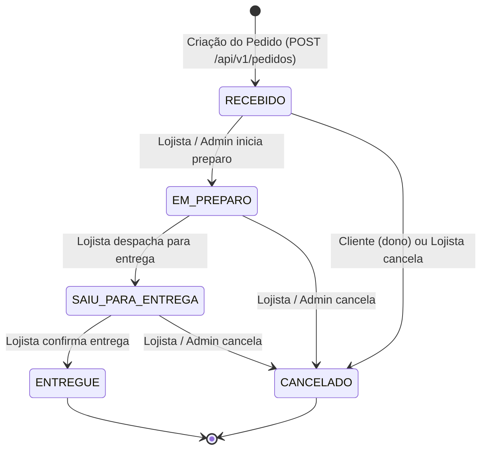

# DeliveryTracker MVP — Sistema de Rastreamento de Pedidos de Delivery


Aplicação **Full-Stack** de gestão e rastreamento de pedidos de entrega em tempo real, construída sob **Vertical Slice Architecture** no back-end (**Spring Boot 3.3.5 + Java 21 LTS**) e **SPA responsiva Mobile-First** no front-end (**React 18 + TypeScript + Tailwind CSS**).

---

## Sumário

1. [Visão Geral e Regras de Negócio](#1-visão-geral-e-regras-de-negócio)
2. [Stack Tecnológica e Padronização](#2-stack-tecnológica-e-padronização)
3. [Guia de Instalação e Execução](#3-guia-de-instalação-e-execução)
4. [Arquitetura e Diagramas C4](#4-arquitetura-e-diagramas-c4)
5. [Máquina de Estados de Pedidos (`OrderStatus`)](#5-máquina-de-estados-de-pedidos-orderstatus)
6. [Documentação da API REST e Swagger UI](#6-documentação-da-api-rest-e-swagger-ui)
7. [Testes Automatizados (Unitários, Slice e E2E), Formatação e CI/CD](#7-testes-automatizados-unitários-slice-e-e2e-formatação-e-cicd)

---

## 1. Visão Geral e Regras de Negócio

| Código   | Requisito Funcional / Regra de Domínio                         | Implementação                                                                                         |
| :------- | :------------------------------------------------------------- | :---------------------------------------------------------------------------------------------------- |
| **RF01** | Cadastro de usuários (`CLIENTE` ou `LOJISTA`) com e-mail único | `POST /api/v1/auth/register` com hash `BCryptPasswordEncoder` (`201 Created` / `409 Conflict`)        |
| **RF02** | Autenticação Stateless com emissão de token JWT                | `POST /api/v1/auth/login` assinado com `HMAC-SHA256` (`JJWT 0.12.6`, expiração padrão `24h`)          |
| **RF03** | Proteção de rotas e controle de acesso por perfil (RBAC)       | `JwtAuthenticationFilter` + `SecurityConfig` (`SessionCreationPolicy.STATELESS`)                      |
| **RF04** | Criação de pedidos com múltiplos itens e cálculo server-side   | `POST /api/v1/pedidos` calcula `subtotal = quantidade * precoUnitario` e `total` com `BigDecimal`     |
| **RF05** | Listagem ordenada por data de criação (`createdAt DESC`)       | `GET /api/v1/pedidos` (`CLIENTE` vê seus próprios pedidos; `LOJISTA`/`ADMIN` visualizam todos)        |
| **RF06** | Consulta detalhada de pedido por identificador `UUID`          | `GET /api/v1/pedidos/{id}` com validação de propriedade ou perfil operacional (`200` / `403` / `404`) |
| **RF07** | Atualização controlada de status do pedido                     | `PATCH /api/v1/pedidos/{id}/status` validado pela máquina de estados `OrderStatus`                    |

---

## 2. Stack Tecnológica e Padronização

### Back-end (`backend/pom.xml`)

- **Linguagem:** Java 21 (LTS) — uso extensivo de `record`s nativos imutáveis para DTOs
- **Framework:** Spring Boot `3.3.5` (`spring-boot-starter-web`, `spring-boot-starter-validation`, `spring-boot-starter-data-jpa`, `spring-boot-starter-security`)
- **Segurança:** Spring Security 6 + JWT (`io.jsonwebtoken:jjwt-api/impl/jackson:0.12.6`) + BCrypt
- **Persistência:**
  - **Perfil `default`:** PostgreSQL `16-alpine` via Docker Compose (`jdbc:postgresql://localhost:5432/delivery_db`)
  - **Perfil `h2`:** H2 Database em arquivo com modo de compatibilidade PostgreSQL (`jdbc:h2:file:./data/delivery_db;AUTO_SERVER=TRUE;MODE=PostgreSQL`)
- **Produtividade & Documentação:** Lombok `1.18.36` (`provided`) + SpringDoc OpenAPI 3 / Swagger UI `2.6.0`
- **Testes:** JUnit 5, Mockito, AssertJ e `spring-security-test` (MockMvc)

### Front-end (`frontend/package.json`)

- **Core & Bundler:** React `18.3.1` + TypeScript `~5.6.2` (`strict: true`, `noUnusedLocals`, `noUnusedParameters`) + Vite `5.4.11`
- **Estilização:** Tailwind CSS `3.4.16` + PostCSS `8.4.49` + Autoprefixer `10.4.20` (Paleta customizada `brand` e design Mobile-First a partir de `360px`)
- **Roteamento & HTTP:** React Router DOM `6.28.0` + Axios `1.7.9` com interceptors JWT (`Authorization: Bearer <token>`)
- **Ícones:** Lucide React `0.468.0`

### Qualidade e Automação do Monorepo (`package.json`, `.prettierrc`)

- **Scripts Centralizados na Raiz:** Orquestração de banco Docker, back-end, front-end, testes e formatação via `npm run <script>`.
- **Formatação Padronizada:** Prettier `3.9.10` + `prettier-plugin-tailwindcss` `0.6.14` (`singleQuote: true`, `semi: true`, `trailingComma: 'all'`, `printWidth: 90`) integrado ao `.vscode/settings.json`.

---

## 3. Guia de Instalação e Execução

### Pré-requisitos

- **Java 21 LTS** (`java -version`)
- **Node.js 20+** e **npm** (`node -v`)
- **Docker** e **Docker Compose** _(Opcional — há suporte nativo ao perfil `h2` caso não deseje utilizar Docker)_

---

### Scripts Rápidos do Monorepo (`package.json` da raiz)

Na raiz do projeto (`delivery-tracking-mvp/`), você dispõe de atalhos prontos para todo o ciclo de execução:

| Comando na Raiz        | O que executa                                                                                |
| :--------------------- | :------------------------------------------------------------------------------------------- |
| `npm run infra:up`     | Sobe o container PostgreSQL 16 (`delivery-tracking-postgres`) em background via Docker       |
| `npm run infra:down`   | Para e remove o container do banco de dados                                                  |
| `npm run dev:back`     | Inicia a API Spring Boot no perfil padrão (`PostgreSQL` na porta `5432`)                     |
| `npm run dev:back:h2`  | Inicia a API Spring Boot com banco **H2 local em modo PostgreSQL** (**dispensa Docker**)     |
| `npm run test:back`    | Executa os 67 testes automatizados do back-end (`mvnw clean test`)                           |
| `npm run dev:front`    | Inicia o servidor de desenvolvimento Vite do front-end (`http://localhost:5173`)             |
| `npm run build:front`  | Valida o TypeScript (`tsc -b`) e gera o bundle de produção do front-end (`frontend/dist`)    |
| `npm run format`       | Formata todos os arquivos (`ts, tsx, js, json, css, md, yml`) com Prettier + plugin Tailwind |
| `npm run format:check` | Verifica se a formatação do código está em conformidade com o `.prettierrc`                  |

---

### Passo 1 — Iniciar o Back-end (Escolha a Opção A ou B)

#### Opção A: Execução Padrão com PostgreSQL 16 via Docker

Na raiz do repositório:

```bash
# 1. Subir o container PostgreSQL 16 (porta 5432, DB: delivery_db, user: delivery_user)
npm run infra:up
# (ou: docker compose up -d)

# 2. Iniciar a API Spring Boot (porta 8080)
cd backend
./mvnw spring-boot:run
```

_(No Windows PowerShell/CMD, utilize `.\mvnw.cmd spring-boot:run` ou diretamente no Bash `npm run dev:back` na raiz)._

#### Opção B: Execução Instantânea sem Docker (Perfil H2 em modo PostgreSQL)

Caso não tenha o Docker em execução na máquina, rode o back-end com persistência local em arquivo (`./data/delivery_db`) compatível com PostgreSQL:

```bash
# Na raiz do repositório:
npm run dev:back:h2

# Ou diretamente na pasta backend/:
cd backend
./mvnw spring-boot:run -Dspring-boot.run.profiles=h2
```

_(No Windows PowerShell/CMD dentro de `backend/`: `.\mvnw.cmd spring-boot:run "-Dspring-boot.run.profiles=h2"`)._

- **API Base URL:** `http://localhost:8080/api/v1`
- **Swagger UI (Documentação Interativa):** `http://localhost:8080/swagger-ui.html`
- **OpenAPI JSON Spec:** `http://localhost:8080/v3/api-docs`
- **Console H2** _(quando ativo no perfil `h2`)_: `http://localhost:8080/h2-console` (`JDBC URL`: `jdbc:h2:file:./data/delivery_db`, `User Name`: `sa`, senha em branco)

---

### Passo 2 — Instalar e Iniciar o Front-end (React + Vite)

Em um segundo terminal, a partir da raiz do projeto:

```bash
# 1. Instalar dependências do front-end
cd frontend
npm install

# 2. Iniciar o servidor de desenvolvimento (porta 5173)
npm run dev
```

_(Ou execute no Bash `npm run dev:front` diretamente na raiz após instalar as dependências)._

> **Variáveis de Ambiente (`frontend/.env.development`):**
> O projeto já inclui `.env.development` pré-configurado apontando para `VITE_PORT=5173` e `VITE_API_BASE_URL=http://localhost:8080/api/v1`. Nenhuma configuração manual adicional é necessária.

- Acesse a aplicação no navegador em: **`http://localhost:5173`**

---

### Passo 3 — Roteiro Sugerido de Avaliação na Interface (`http://localhost:5173`)

1. **Criar conta de Cliente:**
   - Acesse `/register`, preencha Nome, E-mail, Senha (mín. 6 caracteres), mantenha o perfil **Cliente** selecionado e clique em **Concluir cadastro**.
2. **Autenticar e Criar Pedido:**
   - Faça login em `/login`. Na tela `/pedidos`, clique em **Novo Pedido**, informe o endereço de entrega, adicione um ou mais itens com quantidade e preço unitário com suporte a vírgula para centavos (observe o cálculo reativo de subtotais e total em `R$`) e clique em **Salvar Pedido**.
3. **Testar Permissão Operacional de Lojista:**
   - Clique em **Sair**, acesse `/register` e cadastre um segundo usuário selecionando o perfil **Lojista**.
   - Faça login com o usuário **Lojista**: todos os pedidos da loja serão exibidos e você poderá avançar o status do pedido diretamente no seletor do card (`Recebido` → `Em Preparo` → `Saiu Para Entrega` → `Entregue`).

---

### Passo 4 — Testar a API via Coleção do Postman / Insomnia (Opcional)

O repositório disponibiliza uma coleção oficial do **Postman (v2.1)** pronta para importação, com variáveis de ambiente pré-configuradas (`{{jwt_token}}` e `{{pedido_id}}` preenchidos automaticamente via scripts de pós-resposta no Login e na Criação de Pedido):

- **Arquivo da Coleção:** [`backend/docs/api/postman/Delivery Tacking API.postman_collection.json`](backend/docs/api/postman/Delivery%20Tacking%20API.postman_collection.json)
- **Guia de Importação:** [`backend/docs/api/postman/curl-collection.md`](backend/docs/api/postman/curl-collection.md)

**Como utilizar:**

1. Abra o **Postman** (ou **Insomnia**) e clique em **Import**.
2. Selecione o arquivo `backend/docs/api/postman/Delivery Tacking API.postman_collection.json`.
3. Execute **`User → Register User`** e em seguida **`User → Login`** (o script da requisição salvará automaticamente o token JWT na variável `{{jwt_token}}`).
4. Execute as requisições da pasta **`Order`** (`Create an order`, `List Order`, `Id Order` e `Update Order`) — o `{{pedido_id}}` criado também é capturado automaticamente para as chamadas seguintes.

---

## 4. Arquitetura e Diagramas C4

### 4.1 C4 Nível 1 — Diagrama de Contexto



### 4.2 C4 Nível 2 — Diagrama de Containers



### 4.3 C4 Nível 3 — Componentes do Back-end (Vertical Slice Architecture)

O back-end organiza o código por **fatias verticais de domínio** sob `com.delivery.api`, evitando camadas horizontais genéricas acopladas:



### 4.4 Estrutura de Diretórios do Monorepo

```text
delivery-tracking-mvp/
├── .github/workflows/ci.yml       # Pipeline CI/CD (Backend Java 21 + Frontend Node 20)
├── .prettierrc                    # Configuração Prettier + prettier-plugin-tailwindcss
├── .prettierignore                # Exclusão de artefatos de build e bancos locais
├── .vscode/settings.json          # Padronização de editor (formatOnSave, LF, Java/Prettier)
├── docker-compose.yml             # PostgreSQL 16 Alpine com volume persistente e healthcheck
├── package.json                   # Scripts orquestradores do monorepo (infra, dev, test, format)
├── GEMINI.md                      # Diretrizes arquiteturais e padrões de engenharia
├── backend/                       # API RESTful Spring Boot 3.3.5 + Java 21
│   ├── docs/api/postman/          # Coleção oficial do Postman v2.1 e guia de importação
│   ├── pom.xml
│   └── src/
│       ├── main/java/com/delivery/api/
│       │   ├── auth/              # Fatia vertical de Autenticação e Usuários
│       │   ├── order/             # Fatia vertical de Pedidos e Máquina de Estados
│       │   └── shared/            # Segurança JWT, OpenAPI e Tratamento Global de Erros
│       ├── main/resources/
│       │   ├── application.yml    # Configuração padrão (PostgreSQL, JWT, CORS, Swagger)
│       │   └── application-h2.yml # Perfil alternativo H2 em modo PostgreSQL
│       └── test/java/com/delivery/api/ # 67 testes automatizados (Unitários, Slice e E2E)
└── frontend/                      # SPA React 18.3 + TypeScript 5.6 + Tailwind CSS 3.4
    ├── .env.development           # VITE_PORT=5173 e VITE_API_BASE_URL
    ├── package.json               # Scripts dev, build, lint (tsc --noEmit) e preview
    ├── tailwind.config.js         # Tema customizado (cores brand)
    ├── tsconfig.json              # TypeScript estrito (ES2022, strict, noUnusedLocals)
    ├── vite.config.ts             # Servidor Vite configurável via variáveis de ambiente
    └── src/
        ├── api/                   # Instância Axios, interceptors JWT e serviços REST
        ├── components/            # Componentes reutilizáveis (OrderCard, CreateOrderModal, etc.)
        ├── contexts/              # AuthContext com decodificação de claims JWT
        ├── pages/                 # LoginPage, RegisterPage, OrdersPage, NotFoundPage
        ├── routes/                # AppRoutes e ProtectedRoute
        └── types/                 # Contratos TypeScript estritos (sem uso de any)
```

---

## 5. Máquina de Estados de Pedidos (`OrderStatus`)

O ciclo de vida de cada pedido é governado pelo enum [`OrderStatus`](backend/src/main/java/com/delivery/api/order/OrderStatus.java) e protegido contra transições ilegais (retornando `422 Unprocessable Entity` via `InvalidStatusTransitionException`):



- **Regras por Perfil (`Role`):**
  - **`CLIENTE`:** pode criar pedidos, visualizar apenas seus próprios pedidos e cancelar um pedido próprio **exclusivamente enquanto estiver no status `RECEBIDO`**.
  - **`LOJISTA` / `ADMIN`:** visualizam todos os pedidos da plataforma e conduzem as transições operacionais (`RECEBIDO` → `EM_PREPARO` → `SAIU_PARA_ENTREGA` → `ENTREGUE` ou `CANCELADO`).

---

## 6. Documentação da API REST e Swagger UI

Com o back-end em execução, acesse **`http://localhost:8080/swagger-ui.html`** para testar os endpoints diretamente no navegador usando o botão **Authorize (Bearer JWT)**.

### Resumo de Endpoints

| Método  | Rota                          | Autenticação | Status de Sucesso | Descrição                                                  |
| :-----: | :---------------------------- | :----------: | :---------------: | :--------------------------------------------------------- |
| `POST`  | `/api/v1/auth/register`       |   Pública    |   `201 Created`   | Registra usuário (`CLIENTE` ou `LOJISTA`) com senha BCrypt |
| `POST`  | `/api/v1/auth/login`          |   Pública    |     `200 OK`      | Autentica credenciais e retorna token JWT (`Bearer`)       |
| `POST`  | `/api/v1/pedidos`             | `Bearer JWT` |   `201 Created`   | Cria pedido com cálculo server-side de subtotais e total   |
|  `GET`  | `/api/v1/pedidos`             | `Bearer JWT` |     `200 OK`      | Lista pedidos ordenados por `createdAt DESC`               |
|  `GET`  | `/api/v1/pedidos/{id}`        | `Bearer JWT` |     `200 OK`      | Busca detalhes de um pedido específico por `UUID`          |
| `PATCH` | `/api/v1/pedidos/{id}/status` | `Bearer JWT` |     `200 OK`      | Atualiza status do pedido respeitando a máquina de estados |

### Exemplo — Criar Pedido (`POST /api/v1/pedidos`)

**Request Body:**

```json
{
  "enderecoEntrega": "Av. Paulista, 1000 - Apto 42",
  "itens": [
    {
      "nome": "Pizza Margherita Grande",
      "quantidade": 1,
      "precoUnitario": 59.9
    },
    {
      "nome": "Refrigerante 2L",
      "quantidade": 2,
      "precoUnitario": 12.5
    }
  ]
}
```

**Response (`201 Created`):**

```json
{
  "id": "c4e5b9a0-3c4f-4d8a-9b1e-7f2a6d5c8b9e",
  "enderecoEntrega": "Av. Paulista, 1000 - Apto 42",
  "status": "RECEBIDO",
  "total": 84.9,
  "createdAt": "2026-10-20T18:30:00Z",
  "itens": [
    {
      "id": "a1b2c3d4-1111-2222-3333-444455556666",
      "nome": "Pizza Margherita Grande",
      "quantidade": 1,
      "precoUnitario": 59.9,
      "subtotal": 59.9
    },
    {
      "id": "e5f6a7b8-5555-6666-7777-888899990000",
      "nome": "Refrigerante 2L",
      "quantidade": 2,
      "precoUnitario": 12.5,
      "subtotal": 25.0
    }
  ]
}
```

### Contrato Padronizado de Erros (`ErrorResponse`)

Todas as exceções de validação (`400`), autenticação (`401`), permissão (`403`), recurso não encontrado (`404`), conflito (`409`) e regra de negócio (`422`) são interceptadas pelo `GlobalExceptionHandler`:

```json
{
  "timestamp": "2026-10-20T18:32:10.125Z",
  "status": 400,
  "error": "Bad Request",
  "message": "Erro de validação nos campos informados",
  "path": "/api/v1/pedidos",
  "validationErrors": {
    "enderecoEntrega": "O endereço de entrega é obrigatório",
    "itens[0].quantidade": "A quantidade mínima é 1"
  }
}
```

---

## 7. Testes Automatizados (Unitários, Slice e E2E), Formatação e CI/CD

Todos os **67 testes automatizados** do back-end seguem estritamente o padrão **AAA (Arrange, Act, Assert)** e são executados sem dependência de banco de dados externo.

### Arquitetura da Suíte de Testes (`backend/src/test/java`)

| Camada / Suíte                                                                                                             | Tipo de Teste                    | Cobertura Principal                                                                                                                                 |
| :------------------------------------------------------------------------------------------------------------------------- | :------------------------------- | :-------------------------------------------------------------------------------------------------------------------------------------------------- |
| [`AuthServiceTest`](backend/src/test/java/com/delivery/api/auth/AuthServiceTest.java)                                      | Unitário (`Mockito`)             | Registro com hash BCrypt, normalização de e-mail, conflito `409`, login com emissão de JWT e recusa de credenciais inválidas (`401`)                |
| [`OrderServiceTest`](backend/src/test/java/com/delivery/api/order/OrderServiceTest.java)                                   | Unitário (`Mockito`)             | Cálculo exato de subtotais/total com `BigDecimal`, status inicial `RECEBIDO`, permissões por `Role` e transições válidas vs. bloqueadas (`422`)     |
| [`OrderDomainTest`](backend/src/test/java/com/delivery/api/order/OrderDomainTest.java) & `OrderStatusConverterTest`        | Unitário (Domínio)               | Invariantes de `Order`, `OrderItem`, máquina de estados `OrderStatus` (`nextValidStatuses()`) e sanitização de status legados no JPA                |
| [`JwtServiceTest`](backend/src/test/java/com/delivery/api/shared/security/JwtServiceTest.java) & `JwtAuthenticationFilter` | Unitário (Segurança)             | Assinatura/validação de tokens `HMAC-SHA256`, extração de claims e filtro Stateless                                                                 |
| [`AuthControllerTest`](backend/src/test/java/com/delivery/api/auth/AuthControllerTest.java) & `OrderControllerTest`        | Integração Web (`MockMvc`)       | Contratos HTTP REST, Bean Validation (`400`), proteção de rotas (`401`/`403`) e serialização JSON                                                   |
| **[`DeliveryTrackingE2ETest`](backend/src/test/java/com/delivery/api/DeliveryTrackingE2ETest.java)**                       | **Integração Ponta a Ponta E2E** | **Jornada completa (`register` → `login` → `createOrder` → ciclo `RECEBIDO` até `ENTREGUE`), isolamento multi-cliente e bloqueio pós-cancelamento** |

### Executar a Suíte Completa ou Apenas os Testes E2E

```bash
# Executar todos os 67 testes pela raiz do monorepo:
npm run test:back

# Ou diretamente na pasta backend/:
cd backend
./mvnw clean test

# Executar exclusivamente a suíte de Integração Ponta a Ponta (E2E):
cd backend
./mvnw test -Dtest=DeliveryTrackingE2ETest
```

### Validar Tipagem TypeScript, Build e Formatação Prettier

```bash
# Validar TypeScript estrito (sem emitir arquivos) e gerar build de produção:
cd frontend
npm run lint
npm run build

# Na raiz do monorepo — verificar ou aplicar formatação Prettier + Tailwind:
npm run format:check
npm run format
```

### Pipeline CI/CD (GitHub Actions)

O workflow [`.github/workflows/ci.yml`](.github/workflows/ci.yml) executa automaticamente em cada `push` (`main`, `develop`) ou `pull_request` (`main`):

1. **`backend-check`:** Configura Java 21 (Temurin) com cache Maven e executa `./mvnw clean test` (incluindo testes unitários, de controller e E2E).
2. **`frontend-check`:** Configura Node.js 20 com cache npm, instala dependências com `npm ci`, valida TypeScript com `npm run lint` (`tsc --noEmit`) e compila o bundle de produção com `npm run build`.


## 8. Framework MoSCoW do Projeto (MVP vs. Futuro)
Este quadro organiza o ciclo de vida do software e serve como documentação de produto para o próprio repositório:

## 4. Framework MoSCoW do Projeto (MVP vs. Futuro)

| Categoria | Requisitos e Funcionalidades | Justificativa / Impacto |
| :--- | :--- | :--- |
| **Must Have** *(Obrigatório para o MVP)* | - Autenticação JWT com isolamento de perfis RBAC (`CLIENTE` vs. `LOJISTA`/`ADMIN`).<br>- Criação de pedidos com itens dinâmicos e cálculo estrito de subtotal/total no back-end.<br>- Máquina de estados com regras operacionais de transição (`RECEBIDO` $\rightarrow$ `EM_PREPARO` $\rightarrow$ `SAIU_PARA_ENTREGA` $\rightarrow$ `ENTREGUE`).<br>- Regra de cancelamento restrita a clientes para pedidos em estado inicial (`RECEBIDO`).<br>- Isolamento multi-inquilino de pedidos (cliente só enxerga seus pedidos; lojista tem visão global).<br>- Persistência em banco relacional (PostgreSQL e H2 para testes rápidos).<br>- Interface web responsiva em React + TypeScript + Tailwind CSS. | Garantir a integridade do ciclo central de rastreamento de entregas, conformidade de segurança e avaliação imediata sem pendências de negócio. |
| **Should Have** *(Importante, com alto valor agregado)* | - Sanitização retrocompatível de enums legados via JPA `AttributeConverter` (`ENVIADO` $\rightarrow$ `SAIU_PARA_ENTREGA`).<br>- Suíte abrangente de testes unitários (AAA) e testes de integração ponta a ponta (E2E MockMvc).<br>- Pipeline automatizada de CI via GitHub Actions com validação de build e testes a cada commit.<br>- Coleção exportada do Postman (v2.1) e guia de cURLs prontos para execução no terminal.<br>- Documentação interativa via Swagger UI / OpenAPI Spec. | Elevar a manutenibilidade, Developer Experience (DX) para avaliadores e confiabilidade em deploy contínuo. |
| **Could Have** *(Desejável para próximas iterações)* | - Atualização de status em tempo real via WebSockets ou Server-Sent Events (SSE).<br>- Paginação e ordenação dinâmica server-side na listagem de pedidos.<br>- Filtros combinados por data de emissão, faixa de valor e status específico no front-end.<br>- Tema escuro (*Dark Mode*) configurável na UI. | Enriquecer a experiência interativa do usuário sem bloquear o lançamento do MVP. |
| **Won't Have** *(Fora do escopo do MVP — Backlog Futuro)* | - Gateway de pagamento online integrado (Pix, Cartão de Crédito).<br>- Rastreamento georreferenciado com telemetria GPS e mapas ao vivo.<br>- Sistema de frete dinâmico integrado a APIs de terceiros.<br>- App mobile nativo dedicado (Android/iOS). | Evitar complexidade acidental e manter o foco na avaliação da arquitetura e qualidade de código central. |
